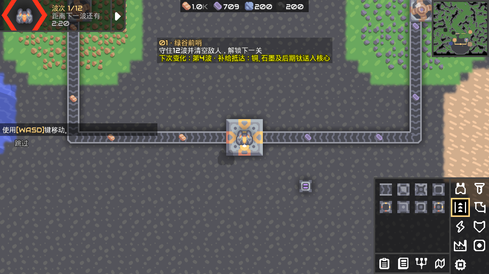

# Mindustry：守望十关战役

在 Mindustry v160.7 上新增独立星球 **守望（Watch）**，把产线与塔防组合成十关递进战役。每关都有固定的战略路线、资源分布和波次事件，玩家需要根据地形和战况调整防线。

当前版本：**0.2.0**。原项目作者为 Anuken 及 Mindustry 社区；本仓库是课程实践的派生版本。原 README 保存为 [README.upstream.md](README.upstream.md)。

[源码仓库](https://github.com/lxy666-qwq/mindustry-watch-campaign) · [版本下载](https://github.com/lxy666-qwq/mindustry-watch-campaign/releases) · [更新日志](CHANGELOG.md)

## 开始游戏

Windows 本地完整环境位于 `D:\软件工程`：

1. 双击 `守望十关.bat`。
2. 主菜单点击 **守望 0.2.0 · 十关战役**。
3. 选择 **01 · 绿谷前哨**，进入关卡。小地图可观察主路和预先标出的侧翼出生点。
4. 核心旁的信息板保存本关简报，屏幕上方显示胜利目标和下一次事件。
5. 完成规定波次并消灭全部敌人后，下一关自动解锁。打开星球地图继续。

`守望十关.bat` 使用独立的 `守望存档` 目录。`开始游戏.bat` 继续使用原来的 `游戏数据` 目录。退出前使用游戏的正常保存功能。

下载版本包的玩家需要 Java 17，运行 `java -Dnodiscord -jar Mindustry.jar`，随后点击上述入口。版本包自带 Windows `start.bat`。程序内版本读取 `core/assets/watch-version.txt`。



## 内容

每关提供铜、铅基础采矿线，启动物资、两座双管炮和短墙；第一波前有三分钟准备时间。产线负责弹药和扩张，主要挑战来自防御布局。科技按关卡直接开放，未开放的设施不能建造；进入守望不会写入原战役的方块科技解锁状态。

| 关卡 | 地形与重点 | 波数 | 主要变化 |
| --- | --- | ---: | --- |
| 01 绿谷前哨 | 弯曲主路，交叉火力 | 12 | 4补给、7侧翼、11装甲 |
| 02 双峡隘口 | 双峡弯道，前沿矿区 | 16 | 5清障、8侧翼、13装甲 |
| 03 冰湖要塞 | 冰湖与永久东桥 | 18 | 6融冰、10空袭、15暴雪 |
| 04 洪泛河谷 | 两岸浅滩与桥梁 | 20 | 7洪水、12补给、16爬虫群 |
| 05 赤沙驿站 | 开阔沙漠与偏远绿洲 | 22 | 7沙尘暴、11恢复、14侧翼、20守护者 |
| 06 潮汐港湾 | 陆路、水道、泊岸炮位 | 24 | 8海军、13退潮与侧翼、21海军守护者 |
| 07 孢子迷林 | 曲折密林与可修复工事 | 26 | 7孢子风暴、12清障、18快速侧翼、24守护者 |
| 08 雷暴高地 | 高地窄路与蓄电需求 | 28 | 8停电、12恢复、17空袭、25装甲 |
| 09 熔岩断层 | 熔岩带、东桥与侧翼 | 30 | 9喷发、15停电、19恢复、27重型守护者 |
| 10 终末堡垒 | 多线综合防御 | 32 | 7侧翼、12空袭、17停电、21恢复、26陆空守护者、30装甲 |

共 **37 个波次事件**。停电期间发电机停机，电池与实弹炮塔仍可工作；沙尘暴期间太阳能倍率降至15%。地形变化避开玩家建筑，洪水及喷发保留永久东侧通路。事件与奖励记录进入正常存档，重新载入不会重复发放。

详细规则见 [关卡说明](docs/CAMPAIGN.md)，改动记录见 [CHANGELOG.md](CHANGELOG.md)，验证范围见 [v0.2.0 验证记录](docs/verification-v0.2.0.md)。

## 从源码构建

依赖：JDK 17、Gradle 9.3.1；Windows 本地环境已放在 `D:\软件工程\工具`。匹配的 Arc 位于源码目录的同级 `../Arc`，其固定版本来自 v160.7 的依赖配置。

发布页同时提供 `Arc-source-v160.7.zip`。解压后保留同级 `Mindustry/` 与 `Arc/` 目录即可使用本地复合构建；源码和框架下载链接随每个版本保留。

在本地完整目录，双击 `编译源码.bat` 或 `运行测试.bat`；也可以运行：

```powershell
powershell -NoProfile -ExecutionPolicy Bypass -File ..\项目操作.ps1 -Action build
powershell -NoProfile -ExecutionPolicy Bypass -File ..\项目操作.ps1 -Action test
```

普通源码环境使用项目自带 Gradle Wrapper：

```bash
./gradlew desktop:dist
./gradlew tests:test
```

构建产物为 `desktop/build/libs/Mindustry.jar`。本机首次通过系统代理下载依赖，后续使用本地 Gradle 缓存；运行无需联网。

## 代码位置

| 文件 | 作用 |
| --- | --- |
| `core/src/mindustry/content/WatchCampaign.java` | 星球、十关参数、装备、敌人波次、科技顺序 |
| `core/src/mindustry/maps/planet/WatchMapGenerator.java` | 地形、路线、矿点与启动设施 |
| `core/src/mindustry/content/WatchCampaignEvents.java` | 事件、预告、存档记录、停电恢复 |
| `core/src/mindustry/core/Logic.java` | 在敌人出生前执行本波事件 |
| `core/src/mindustry/ctype/UnlockableContent.java` | 守望科技开放的作用范围 |
| `tests/src/test/java/WatchCampaignTests.java` | 路线、事件、存档及基础产线测试 |

## 版本保存

使用 `coursework-vX.Y.Z` 标签记录已完成版本。源代码通过 Git 提交保存，程序、源码压缩包及说明另存到 `D:\软件工程\版本归档\vX.Y.Z`，GitHub Releases 用于分发。构建产物、缓存、个人存档与课程 Word 不提交到源码仓库。

- `coursework-v0.1.0`：v160.7 原始源码配置和验证基线。
- `coursework-v0.2.0`：守望十关、地形事件、独立存档及版本文档。

后续迭代流程见 [发布流程](docs/RELEASE_PROCESS.md)。当前版本已验证功能和路线，尚未完成十关的人工完整通关与难度平衡评估。

## 许可证

沿用 [GPL-3.0](LICENSE)，保留上游版权、许可证与来源说明。原项目：[Anuken/Mindustry](https://github.com/Anuken/Mindustry)，框架：[Anuken/Arc](https://github.com/Anuken/Arc)。
