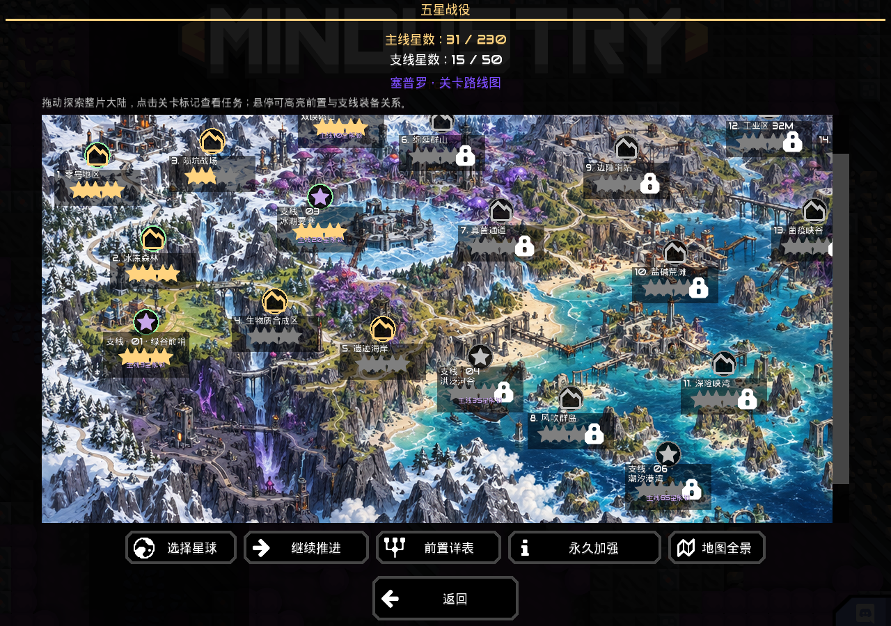
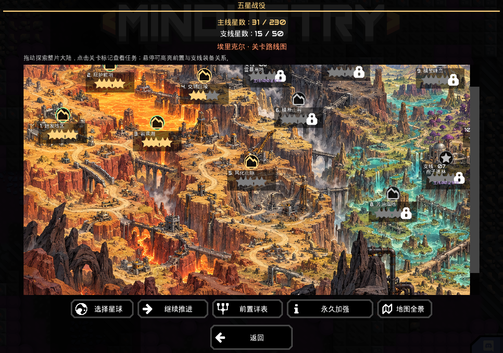

# 连续绘制的战役地图（v0.4.0）

主菜单进入“五星战役 0.4.0”，先点击Serpulo或Erekir，展开可拖动的完整大陆地图。地图包含连续的山地、森林、河流、海岸、桥梁、矿区和堡垒；关卡标记嵌在场景中，主线总体从左往右推进，守望支线位于对应锚点附近。

Serpulo含29主线、6支线；Erekir含17主线、4支线，共56关。主线用城塞标记，支线用紫色星形标记。每个节点显示普通3星、英雄1星、战术1星的最佳成绩；锁定节点仍可点击查看完整条件。悬停标记高亮其实际前置及支线装备关系，金色为主线前置、紫色为支线/满星装备关系。

鼠标按住地图拖动即可移动，窄窗口还可上下拖动。“继续推进”定位可用而未完成的支线，随后定位未完成普通主线；“前置详表”保留原始树状条件，“永久加强”列出奖励，“地图全景”展示完整美术地图。

地图美术依据关卡地貌设计，是连续场景示意；绘制的桥梁、堡垒和道路不决定解锁，也不是扇区坐标的精确还原。实际解锁仍以任务详情为准，详情保留每关原生初始地图缩影。[美术来源及完整提示词](artwork-v0.4.0.md)。

已有最高星、支线满星奖励、战斗参数和存档格式保持原规则。本轮只更新导航与场景美术；全168模式实战的未完成范围不因UI验收而变化。[验证记录](verification-v0.4.0.md)。
