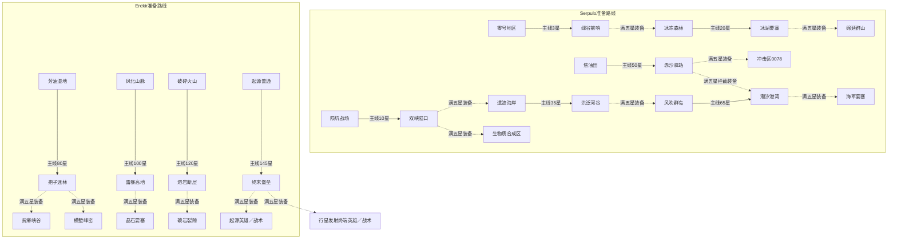

# 五星战役与守望支线（v0.3.3预览版）

每个参与关卡包含一个普通任务和两个独立挑战：普通最多3星，英雄挑战1星，战术挑战1星，共5星。英雄与战术复用本关地图、原胜利目标和地图脚本，以不同敌军强度与附加任务改变应对方法。完成一次普通任务后可选择两种挑战；指定关卡还须满足对应支线满五星的装备准备。

## 参与范围

- Serpulo的29个命名科技主线关卡、Erekir的17个命名主线关卡，共46关、230星。
- 原守望十关成为上述主线附近的10个支线关卡，同样各5星，共50星。
- 56关分别提供3种模式，共168个任务，总上限280星。支线解锁只累计46个主线关卡的星数，包括主线的普通、英雄、战术成绩；支线星数不计入门槛。
- Serpulo普通编号区域及无科技主线节点的`fallenVessel`、`geothermalStronghold`、`cruxscape`三个投稿预设保留原状，不纳入五星任务。

原版地图参数、资源、解锁依赖和地图脚本可在[原版逐关资料](ORIGINAL_CAMPAIGN.md)查阅。v0.1.0原版归档、v0.2.0独立守望星球归档继续保留；v0.3系列的入口为五星战役。

## 普通三星如何取得

| 成绩 | 条件 |
|---|---|
| 第1星 | 完成本关原胜利目标；生存图守住要求波次并清空敌人，进攻图摧毁敌方核心 |
| 第2星 | 完成目标，且本次任务全程没有己方核心被摧毁 |
| 第3星 | 完成目标，且本次任务中所有己方核心的最低生命比例始终不低于70% |

记录的是全程最低核心生命，维修不会抹除早先受损记录。重玩只保留各模式最高成绩，失败或较差成绩不会扣掉已有星数。普通模式仍使用地图原有敌人强度；原版分阶段任务保留先防守、后进攻的目标。

已有原版占领记录按完成普通目标认定为1星。旧存档没有完整核心受损记录，不能直接认定为3星；从旧版中途存档首次接入记录后通关，同样最多补1星。想取得普通第2、第3星可从任务入口重玩。

## 两种一星挑战

英雄挑战与战术挑战分别存分，各最多1星。均须完成原图目标；附加目标未达成时，本次挑战不授星。两种挑战都不允许失去核心。

| 模式 | 敌军变化 | 附加目标 |
|---|---|---|
| 英雄挑战 | 单位生命＋25%、单位与敌方炮塔攻击＋15%、敌方建筑生命＋10%；波次间隔缩短15% | 全程核心生命≥85%；在本关时限内通关；敌方摧毁的己方建筑不超过本关上限 |
| 战术挑战 | 单位生命＋12%、单位与敌方炮塔攻击＋8%；波次间隔缩短5% | 全程核心生命≥60%；在累计建造预算内，保留符合本关类型的新增且实际运行的运输与生产设施 |

地图未启用计时波次时，波间调整不另行生成波次；原版世界处理器仍按其原有逻辑执行。英雄时限按地图防守／进攻长度设置，战术预算按地图面积与初始敌方核心数量设置。开始前的任务说明列出本关英雄时限、战术建造预算与设施要求；任务面板持续显示实际进度。

战术运输目标只计本次新增、胜利时仍保留的基础传送带、物流管或导管。它必须曾真实送出资源，并沿实际交接链进入核心库存、转为有效物品／液体弹药，或送入随后确有产出或发电的设施。至少一次有效终端供给即可，不要求持续吞吐；满核心烧毁资源、闲置生产设施、只送入冷却液或没有终端的物流闭环不计数。桥、路由器、卸载器和质量驱动器可以连接实际供给路径，但本身不计基础运输设施数量；交叉器的直行通道按方向和资源分别记录，不能借另一条交叉线路凑数。物资与液体运输按关卡类型分别统计。 产出终端限实际物品、液体或电力产出，单纯制造单位的工厂不单独满足终端条件。收入核心的物品还须有真实物品产出或玩家实际投放来源，核心卸载后返回同一或另一核心不计运输贡献；核心附属容器共享核心库存，也视为核心边界。矿源与核心卸载线路合流时，仅计有真实来源的有效路径，不能借矿源给另一条纯回流支路授分。核心物资送到有效弹药塔或随后确有产出的工厂仍可计。规则以至少一次真实供给和历史交接为准，并非逐件物资数量追踪；正常玩家实际投放属于允许来源，持续吞吐及库存混合的时序边界仍需平衡试玩核查。

生产目标要求2座本次新增设施确有产出或真实发电，胜利前60秒内仍曾产出，并在胜利时存活。最后60秒限制只适用于生产目标；运输目标只需此前完成有效供给。谷地使用采矿设施，冰原／火山使用发电设施，工业／孢子使用加工设施，水路使用抽水设施；Erekir水路任务也接受排气冷凝器。

初始地图设施始终不算新增，空运到其他位置也不改变身份。新增设施的实际输送与产出记录随空运保留；每次空运落地计入一次累计建造，拆建也增加建造数。单位携带及载荷设施内部的建筑身份、输送／产出记录随任务存读档继续，落地后仍沿用原身份。实际交接边与消费者输入证据同样保存，读档后重建供给链。v0.3.3将运输证据版本改为2：读取版本1或更早的战术任务时，只清旧流向、消费输入和运输确认，需重新实际供给。真实送出记录、生产时刻、资产与载荷身份、世界库存、建造预算、时间、核心最低生命、已有最高星及永久奖励保留。新来源和历史核心边界随专用保存块继续；曾并入核心的同一容器资产保留边界，解绑或核心拆毁不会洗掉来源，正常拆建为新资产后重新计本次实际供给。

### 逐关挑战配置

下表的类型是挑战任务档位，具体地形仍以原图为准。英雄的核心生命和时限要求对各关均有效；表中的时限、建筑损失上限与建造预算对应当前规则；暂停不增加用时。战术栏列出结束时需要保留的新增且实际运行的设施。

#### Serpulo（29关）

| 关卡 | 任务档位 | 英雄时限（秒） | 英雄建筑损失上限 | 战术建造预算 | 战术新增运行目标 |
|---|---|---:|---:|---:|---|
| [零号地区](original-v160.7/levels/groundZero.md) | 谷地 | 2256 | 16座 | 200座 | 16座物资运输设施＋2座采矿设施 |
| [盐碱荒滩](original-v160.7/levels/saltFlats.md) | 谷地 | 2880 | 16座 | 283座 | 16座物资运输设施＋2座采矿设施 |
| [实验禁区](original-v160.7/levels/testingGrounds.md) | 工业 | 5238 | 24座 | 238座 | 24座物资运输设施＋2座加工设施 |
| [冰冻森林](original-v160.7/levels/frozenForest.md) | 冰原 | 3334 | 12座 | 161座 | 16座物资运输设施＋2座发电设施 |
| [生物质合成区](original-v160.7/levels/biomassFacility.md) | 孢子 | 3628 | 14座 | 196座 | 16座物资运输设施＋2座加工设施 |
| [孢染丛林](original-v160.7/levels/taintedWoods.md) | 孢子 | 6365 | 14座 | 220座 | 16座物资运输设施＋2座加工设施 |
| [陨坑战场](original-v160.7/levels/crateredBattleground.md) | 谷地 | 3012 | 16座 | 200座 | 16座物资运输设施＋2座采矿设施 |
| [遗迹海岸](original-v160.7/levels/ruinousShores.md) | 水路 | 6673 | 22座 | 236座 | 12座液体运输设施＋2座抽水设施 |
| [深险峡湾](original-v160.7/levels/perilousHarbor.md) | 水路 | 2940 | 22座 | 457座 | 12座液体运输设施＋2座抽水设施 |
| [工业区 32M](original-v160.7/levels/facility32m.md) | 工业 | 4160 | 24座 | 194座 | 24座物资运输设施＋2座加工设施 |
| [风吹群岛](original-v160.7/levels/windsweptIslands.md) | 水路 | 5616 | 22座 | 346座 | 12座液体运输设施＋2座抽水设施 |
| [绵延群山](original-v160.7/levels/stainedMountains.md) | 谷地 | 6456 | 16座 | 238座 | 16座物资运输设施＋2座采矿设施 |
| [萃取前哨](original-v160.7/levels/extractionOutpost.md) | 工业 | 3240 | 24座 | 456座 | 24座物资运输设施＋2座加工设施 |
| [边际海湾](original-v160.7/levels/coastline.md) | 水路 | 5637 | 22座 | 387座 | 12座液体运输设施＋2座抽水设施 |
| [风化海峡](original-v160.7/levels/weatheredChannels.md) | 水路 | 7464 | 22座 | 484座 | 12座液体运输设施＋2座抽水设施 |
| [海军要塞](original-v160.7/levels/navalFortress.md) | 水路 | 4140 | 22座 | 481座 | 12座液体运输设施＋2座抽水设施 |
| [边陲哨站](original-v160.7/levels/frontier.md) | 谷地 | 2580 | 16座 | 302座 | 16座物资运输设施＋2座采矿设施 |
| [真菌通道](original-v160.7/levels/fungalPass.md) | 孢子 | 2160 | 14座 | 247座 | 16座物资运输设施＋2座加工设施 |
| [菌疫峡谷](original-v160.7/levels/infestedCanyons.md) | 孢子 | 2940 | 14座 | 316座 | 16座物资运输设施＋2座加工设施 |
| [环礁群岛](original-v160.7/levels/atolls.md) | 水路 | 4020 | 22座 | 567座 | 12座液体运输设施＋2座抽水设施 |
| [沉没码头](original-v160.7/levels/sunkenPier.md) | 水路 | 6680 | 22座 | 411座 | 12座液体运输设施＋2座抽水设施 |
| [菌丝堡垒](original-v160.7/levels/mycelialBastion.md) | 孢子 | 4140 | 14座 | 373座 | 16座物资运输设施＋2座加工设施 |
| [增生区](original-v160.7/levels/overgrowth.md) | 孢子 | 2880 | 14座 | 327座 | 16座物资运输设施＋2座加工设施 |
| [焦油田](original-v160.7/levels/tarFields.md) | 火山 | 5532 | 20座 | 204座 | 12座液体运输设施＋2座发电设施 |
| [冲击区 0078](original-v160.7/levels/impact0078.md) | 冰原 | 6820 | 12座 | 238座 | 16座物资运输设施＋2座发电设施 |
| [荒芜裂谷](original-v160.7/levels/desolateRift.md) | 火山 | 3600 | 20座 | 167座 | 12座液体运输设施＋2座发电设施 |
| [核裂阵](original-v160.7/levels/nuclearComplex.md) | 冰原 | 10376 | 12座 | 196座 | 16座物资运输设施＋2座发电设施 |
| [海滨船厂](original-v160.7/levels/littoralShipyard.md) | 水路 | 4620 | 22座 | 833座 | 12座液体运输设施＋2座抽水设施 |
| [行星发射终端](original-v160.7/levels/planetaryTerminal.md) | 工业 | 4560 | 24座 | 593座 | 24座物资运输设施＋2座加工设施 |

#### Erekir（17关）

| 关卡 | 任务档位 | 英雄时限（秒） | 英雄建筑损失上限 | 战术建造预算 | 战术新增运行目标 |
|---|---|---:|---:|---:|---|
| [始发地区](original-v160.7/levels/onset.md) | Erekir通用 | 1860 | 16座 | 593座 | 16座物资运输设施＋2座采矿设施 |
| [庇护前哨](original-v160.7/levels/aegis.md) | Erekir通用 | 2280 | 16座 | 391座 | 16座物资运输设施＋2座采矿设施 |
| [岩浆湖](original-v160.7/levels/lake.md) | 水路 | 2580 | 22座 | 302座 | 12座液体运输设施＋2座抽水／冷凝设施 |
| [交错丘陵](original-v160.7/levels/intersect.md) | Erekir通用 | 4168 | 16座 | 505座 | 16座物资运输设施＋2座采矿设施 |
| [风化山脉](original-v160.7/levels/atlas.md) | Erekir通用 | 3420 | 16座 | 808座 | 16座物资运输设施＋2座采矿设施 |
| [横断山谷](original-v160.7/levels/split.md) | Erekir通用 | 1980 | 16座 | 698座 | 16座物资运输设施＋2座采矿设施 |
| [风蚀盆地](original-v160.7/levels/basin.md) | Erekir通用 | 4080 | 16座 | 898座 | 16座物资运输设施＋2座采矿设施 |
| [芳油湿地](original-v160.7/levels/marsh.md) | 水路 | 2580 | 22座 | 673座 | 12座液体运输设施＋2座抽水／冷凝设施 |
| [横堑峰峦](original-v160.7/levels/peaks.md) | Erekir通用 | 2460 | 16座 | 376座 | 16座物资运输设施＋2座采矿设施 |
| [贫瘠峡谷](original-v160.7/levels/ravine.md) | Erekir通用 | 4860 | 16座 | 475座 | 16座物资运输设施＋2座采矿设施 |
| [破碎火山](original-v160.7/levels/caldera-erekir.md) | 火山 | 2580 | 20座 | 456座 | 12座液体运输设施＋2座发电设施 |
| [晶石要塞](original-v160.7/levels/stronghold.md) | 工业 | 5100 | 24座 | 1078座 | 24座物资运输设施＋2座加工设施 |
| [碳岩裂隙](original-v160.7/levels/crevice.md) | Erekir通用 | 8472 | 16座 | 475座 | 16座物资运输设施＋2座采矿设施 |
| [平行岭谷](original-v160.7/levels/siege.md) | 工业 | 4320 | 24座 | 649座 | 24座物资运输设施＋2座加工设施 |
| [十字路口](original-v160.7/levels/crossroads.md) | 工业 | 3840 | 24座 | 622座 | 24座物资运输设施＋2座加工设施 |
| [岩溶洞穴](original-v160.7/levels/karst.md) | 火山 | 7884 | 20座 | 653座 | 12座液体运输设施＋2座发电设施 |
| [起源](original-v160.7/levels/origin.md) | 火山 | 5820 | 20座 | 1058座 | 12座液体运输设施＋2座发电设施 |

## 十条守望支线

每条支线需要达到对应主线总星数，并完成锚点主线的普通任务。它们在五星列表中紧接对应主线显示，星球地图上也分布到锚点附近。潮汐港湾的三种模式还需要赤沙驿站满五星，确保先解锁海军炮弹反制装备；其他支线按各自列出的前置开放。

| 支线 | 所在星球／锚点 | 主线星数门槛 | 地图尺寸／防守波次 | 关键波次事件 |
|---|---|---:|---|---|
| 绿谷前哨 | Serpulo／零号地区 | 3 | 144×144／12波 | 第4波补给，第7波侧翼，第11波装甲 |
| 双峡隘口 | Serpulo／陨坑战场 | 10 | 144×144／16波 | 第5波清障，第8波侧翼，第13波装甲 |
| 冰湖要塞 | Serpulo／冰冻森林 | 20 | 160×160／18波 | 第6波融冰，第10波空军，第15波暴雪 |
| 洪泛河谷 | Serpulo／遗迹海岸 | 35 | 160×160／20波 | 第7波洪水，第12波补给，第16波集群 |
| 赤沙驿站 | Serpulo／焦油田 | 50 | 176×176／22波 | 第7波沙尘暴，第11波恢复，第14波侧翼，第20波守护者 |
| 潮汐港湾 | Serpulo／风吹群岛 | 65 | 176×176／24波 | 第8波海军，第13波退潮，第21波守护者 |
| 孢子迷林 | Erekir／芳油湿地 | 80 | 176×176／26波 | 第7波孢子风暴，第12波清障，第18波快速侧翼，第24波守护者 |
| 雷暴高地 | Erekir／风化山脉 | 100 | 192×192／28波 | 第8波停电，第12波恢复，第17波空军，第25波装甲 |
| 熔岩断层 | Erekir／破碎火山 | 120 | 192×192／30波 | 第9波喷发，第15波停电，第19波恢复，第27波守护者 |
| 终末堡垒 | Erekir／起源 | 145 | 192×192／32波 | 第7波侧翼，第12波空军，第17波停电，第21波恢复，第26波陆空守护者，第30波装甲 |

守望地图的预置发电机、节点与电池显式建立电网连接；电池可正常充电，停电事件期间按原蓄电机制供能，恢复发电后继续充电。

十条支线共保留37个波次事件。事件与初始设施的具体效果见[守望地形与事件说明](CAMPAIGN.md)。位于Erekir的守望支线仍使用守望原有装备、敌人和地形规则；其地图内装备与支线奖励按五星任务的装备规则开放，不写入原生Erekir基地科技。

支线选址先使用附近空闲格。若候选位置已有原版预设或玩家基地，则寻找其他空闲位置；实际位置写入本地设置，后续启动使用同一位置。已有基地不会为了放置支线被覆盖。

### 支线挑战配置

| 支线 | 英雄时限（秒） | 英雄建筑损失上限 | 战术建造预算 | 战术新增运行目标 |
|---|---:|---:|---:|---|
| 绿谷前哨 | 1493 | 16座 | 160座 | 16座物资运输设施＋2座采矿设施 |
| 双峡隘口 | 2039 | 24座 | 160座 | 24座物资运输设施＋2座加工设施 |
| 冰湖要塞 | 2221 | 12座 | 160座 | 16座物资运输设施＋2座发电设施 |
| 洪泛河谷 | 2403 | 22座 | 160座 | 12座液体运输设施＋2座抽水设施 |
| 赤沙驿站 | 2907 | 20座 | 160座 | 12座液体运输设施＋2座发电设施 |
| 潮汐港湾 | 3117 | 22座 | 160座 | 12座液体运输设施＋2座抽水设施 |
| 孢子迷林 | 3327 | 14座 | 160座 | 16座物资运输设施＋2座加工设施 |
| 雷暴高地 | 3537 | 24座 | 160座 | 24座物资运输设施＋2座加工设施 |
| 熔岩断层 | 3747 | 20座 | 160座 | 12座液体运输设施＋2座发电设施 |
| 终末堡垒 | 3957 | 24座 | 160座 | 24座物资运输设施＋2座加工设施 |

## 关卡树与装备准备

五星列表的“关卡树”按原科技主线显示缩进路径，守望支线紧接对应锚点。关卡卡片同时列出原版占领前置、支线主线星数门槛，以及指定支线满五星的装备准备条件。原科技树存在多个占领前置，缩进只表示其中的主路径；其他条件仍须同时完成，不能只沿一条缩进路径进入关卡。

下图列出新增的支线准备关系，实线表示“锚点普通通关＋主线星数”，虚线表示“支线满五星后才开放目标任务”。未画出的原版主线前置继续有效。

满五星支线同时开放下表中的装备和后勤奖励。装备按任务所属装备环境提供：Serpulo主线及全部守望支线使用Serpulo列，Erekir官方主线使用Erekir列。装备开放并不免费生成建筑，建造材料、供电、弹药、液体和生产链仍按原方块规则提供。

| 满五星支线 | 必须先取得奖励的目标任务 | Serpulo／守望装备 | Erekir主线装备 |
|---|---|---|---|
| 绿谷前哨 | 冰冻森林的三种模式 | 分裂、战地绷带塔 | 撕裂、战地绷带塔 |
| 双峡隘口 | 遗迹海岸、生物质合成区的三种模式 | 电弧、蓝瑟 | 扩散 |
| 冰湖要塞 | 绵延群山的三种模式 | 波浪、机械泵、导管 | 排气冷凝器、强化导管 |
| 洪泛河谷 | 风吹群岛的三种模式 | 冰雹、浪涌 | 扩散、飞船制造厂 |
| 赤沙驿站 | 冲击区0078、潮汐港湾的三种模式 | 蜂群、裂解 | 驱离 |
| 潮汐港湾 | 海军要塞的三种模式 | 海啸、空军工厂 | 升华、强化泵 |
| 孢子迷林 | 贫瘠峡谷、横堑峰峦的三种模式 | 修理投影 | 升华、强化泵 |
| 雷暴高地 | 晶石要塞的三种模式 | 大型电池 | 劫难、热量路由器 |
| 熔岩断层 | 碳岩裂隙的三种模式 | 厄兆、力墙投影 | 光辉、再生投影器 |
| 终末堡垒 | 起源、行星发射终端的英雄／战术挑战 | 维修点 | 单位维修塔 |

潮汐港湾本身没有钍和相织布生产链。赤沙驿站满五星后，潮汐三种模式的新任务各提供一次钍80、相织布40，供一台原生裂解拦截炮的稀缺材料；其另外硅130、钛40造价和实际供电仍正常消耗，续档不补发，仅这张图提供。原生裂解移除有溅射的弹丸会使其在截击点引爆，宜布置在来弹方向，保证爆点远离核心；它没有修改原生攻击、敌人或伤害规则。一台是否足够满星以实际战斗记录为准。

晶石要塞原图没有矿渣或废料，无法就地产出劫难的100巨浪合金造价。因此在雷暴高地满五星后，每次新开的晶石要塞五星任务提供一次100巨浪合金有限建造包，普通、英雄、战术均适用；仅此地图，续档不补发。它供建造一座劫难，其他材料、热量、供电与弹药仍由玩家准备，装备条件中公开列出这项补给。

起源和行星发射终端的普通任务不要求终末堡垒满星，避免“先完成自身挑战才能解锁自身锚点”的循环。终末堡垒仍需起源普通通关及145主线星。所有装备永久奖励仍只来自支线满五星，主线星数不会发装备或后勤奖励。

## 满五星的永久加强

永久奖励的唯一来源是支线满5星：该支线须取得普通3星、英雄1星、战术1星。主线普通、英雄、战术通关或获得任何星数都不授予永久奖励。星级保留最高成绩，奖励随该支线满星状态持续有效，不因重复通关累计第二份。

| 满五星支线 | 永久奖励 |
|---|---|
| 绿谷前哨 | 建造速度＋2%，解锁战地绷带塔 |
| 双峡隘口 | 拆除返还率＋3个百分点 |
| 冰湖要塞 | 每次新普通任务额外铜／铍80 |
| 洪泛河谷 | 建造速度＋2% |
| 赤沙驿站 | 拆除返还率＋3个百分点 |
| 潮汐港湾 | 每次新普通任务额外铅／钨50 |
| 孢子迷林 | 建造速度＋2% |
| 雷暴高地 | 拆除返还率＋3个百分点 |
| 熔岩断层 | 每次新普通任务额外煤／石墨50 |
| 终末堡垒 | 建造速度＋2%，拆除返还率＋1个百分点 |

全部取得时，建造速度总增幅为8%，拆除返还率总增幅为10个百分点。建造增幅相对地图原有建造倍率计算；返还率最多100%。奖励全局适用于五星战役的全部主线和支线，包含普通、英雄、战术模式；原生战役基地、编辑器与对战规则保持各自原有设置。

建造／返还奖励适用于普通、英雄、战术模式；80／50／50的后勤启动物资仅在新普通任务中发放，挑战及读档不补发。晶石要塞100巨浪合金建造包是上述专用例外，仅在雷暴高地满五星后的该图新任务发放，三种模式均适用。Serpulo主线和全部守望支线得到铜、铅、煤；Erekir主线得到铍、钨、石墨。物资仍受核心容量限制，不提高基础伤害、最大生命、射程或生产倍率。奖励可减少铺设与调整布局的时间；绷带塔提供有成本和共享冷却的墙体应急修复。核心保护、敌军强度与附加任务仍需完成。

### 战地绷带塔（Field Bandage）

绿谷前哨获得全部5星后永久解锁，在Serpulo、Erekir主线及守望支线的五星任务中可用。

| 参数 | 设置 |
|---|---|
| 统一建造成本 | 50石墨、40硅 |
| 尺寸／自身生命 | 2×2格／280 |
| 范围 | 8格 |
| 修复触发 | 范围内友方墙体生命≤30% |
| 修复量 | 该墙最大生命的15% |
| 消耗 | 每次2石墨；工作时要求0.7供电 |
| 共享冷却 | 同一位置或同一墙体身份60秒 |

冷却同时记录墙体位置与墙体身份，以两者较晚的结束时刻为准，并随任务保存。拆建同一位置的墙或绷带塔、移动原墙、读档、多座塔同时工作均不能刷新。修复对象限友方墙体，不包括核心、炮塔、绷带塔本身或敌方墙体。它降低重伤墙的临时维修压力，仍需要防御布局、石墨补给与真实供电；本版尚未完成全部168任务的实战平衡验证。

## 进入、保存与重玩

1. 本机用`五星战役.bat`进入新版，使用独立`五星存档`；从主菜单进入“五星战役”，选择Serpulo或Erekir。
2. 用“关卡树”查看原版前置、支线锚点与满五星装备准备；点击关卡，阅读所选模式的全部进入条件与任务说明，再点击开始任务。关卡树奖励和任务条件按可用宽度换行，完整显示时限、预算及装备准备。
3. 每次从任务入口开始都会加载初始地图；当前游戏先保存，五星任务另建普通`.msav`存档并自动保存。
4. 使用读档继续同一次任务，核心最低生命、损失、用时、建造数、事件触发记录随存档继续。任务计时使用游戏运行时间，暂停不增加用时。
5. 重玩从初始地图重新尝试，已有星数保留最高成绩；原版扇区基地、库存和占领存档保持原有归属。

任务星级保存在本地设置的`watch-stars-v1.<关卡名>.<模式>`条目，运行中的单次任务状态位于`Rules.tags`的`stars.*`条目；v0.3.2保存时将动态建筑/物流/产出/搬运/绷带冷却写入`watch-stars-ledger`自定义块，固定任务元信息继续内嵌，守望事件状态保存在`watch.*`条目。备份时应同时保留本地设置与任务存档。

## 维护与验证

- [CampaignStars.java](../core/src/mindustry/content/CampaignStars.java)：参与范围、解锁、评分、两种挑战、永久奖励及持久化。
- [star-missions.json](../core/assets/star-missions.json)：原版地图尺寸、波次和初始敌方核心元数据，供开始前预览与运行中限制使用。
- [WatchCampaign.java](../core/src/mindustry/content/WatchCampaign.java)：十条支线锚点、门槛、位置、装备和37个事件配置。
- [CampaignProgression.java](../core/src/mindustry/content/CampaignProgression.java)：原科技树前置、支线满星装备准备与两星球装备对应。
- [CampaignStarsDialog.java](../core/src/mindustry/ui/dialogs/CampaignStarsDialog.java)：五星列表、任务说明、星数和奖励展示。
- [WatchRewardBlocks.java](../core/src/mindustry/content/WatchRewardBlocks.java)：战地绷带塔、实际消耗与共享墙体冷却。

规则参数变化时，应同步本说明、README、CHANGELOG及版本验证记录。自动检查与真实试玩结果在对应版本验证记录中分别列出；全168个任务的连续实战通关与难度平衡尚未完成，仍需实际游戏记录支持。

## v0.3.1 核心生命记录修订

核心的原生生命变更立即记入最低生命，同帧修复不抹去伤害；普通70%、英雄85%、战术60%门槛以及存读档使用同一记录。既有最高成绩保留，旧存档无法补回过去漏记的下降。[验证记录](verification-v0.3.1.md)区分自动回归、桌面合成检查和真实通关。

## v0.3.2 大型任务存档修订

正常大型产线不再因台账超过64KB而无法保存。旧任务档读取后自动沿本版保存方式继续；新档须本版及后续版本读取，旧程序会跳过新动态块。此修订未改变任务评分；核心卸载回流仍需后续评分修复。证据见[本版验证](verification-v0.3.2.md)。
