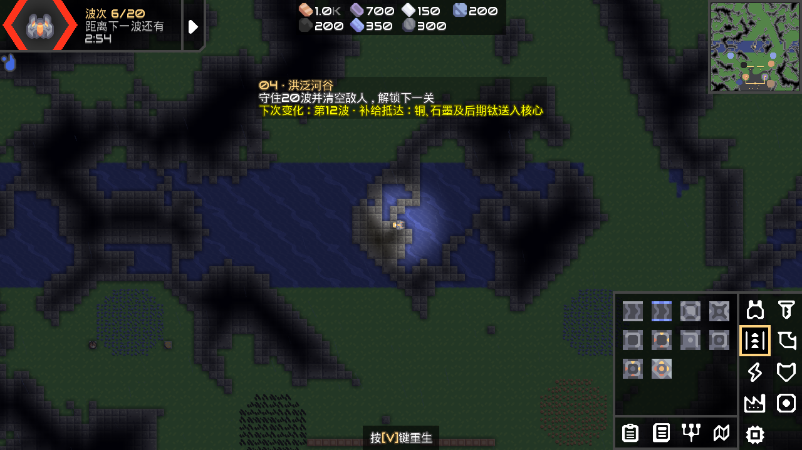
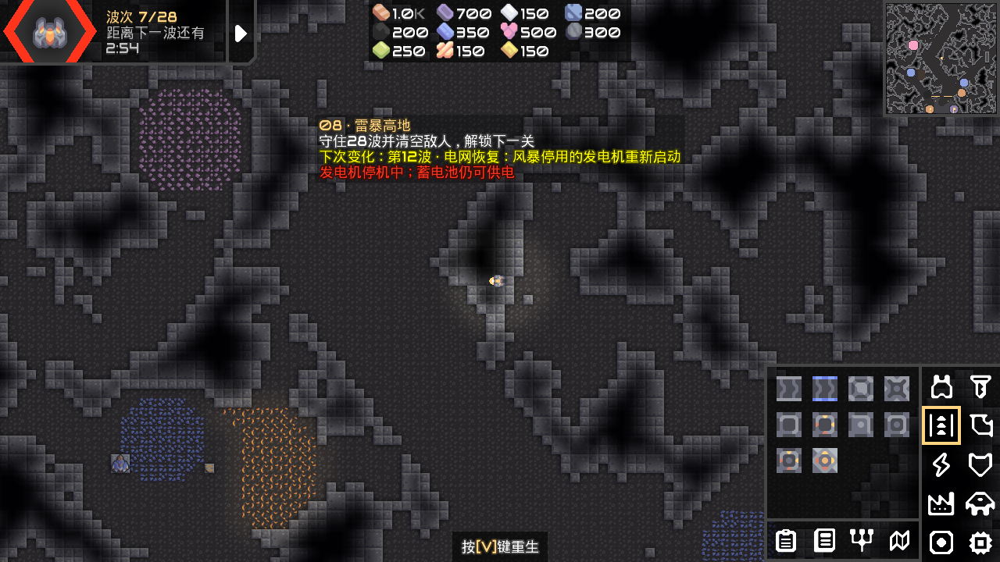

# v0.2.0 验证记录

日期：2026-10-12。系统：Windows；JDK：Temurin 17.0.20.1；Gradle：9.3.1；上游基线：Mindustry v160.7；Arc：该标签的固定依赖版本，采用同级本地复合构建。

## 自动验证

完整回归共**372项测试，0失败、0错误、0跳过**，其中包含27项新增守望测试，以及上游关卡校验自动发现的10个新关卡。桌面发布编译通过。测试XML保存在本机`Mindustry/tests/build/test-results/test/`。

新增测试覆盖：

- 十关地图尺寸、核心、出生点、有限波次与最终波出兵。
- 每个事件不提前触发、执行一次且不重复发放物资。
- 地形变化后保留地面可达路线，洪水不转换建筑所在格。
- 港湾海军进入对核心的射程，退潮后水路仍可用。
- 停电期间已建和新建发电机停机；恢复时保留原本手动关闭的发电机状态。
- 使用真实SaveIO写入并读回`.msav`，保存断电状态与奖励执行记录。
- 科技开放作用范围、上一关完成目标、原星球事件隔离。
- 基础铜、铅采矿线经过模拟更新后确实送入核心。
- 事件在本波敌人出生前执行。

本机入口`项目操作.ps1`会把系统代理参数传给Gradle及它启动的测试JVM，保证上游联网模组测试能取得数据。

## 桌面运行

使用游戏自身DesktopLauncher、SDL及渲染器运行，并把验证存档放在独立工作目录。

- 十关分别生成并渲染，保存主菜单、星球和关卡截图。
- 检查洪水与停电后的HUD信息；最后一关第26波生成25个敌方实体，包含地面与空中守护者编组。
- 通过正常`Control.playSector`入口进入第一关，玩家单位存活，40秒后核心铜由1000增至1009、铅由700增至709。
- 正常入口产生`sector-watch-0.msav`，退出时保存成功。
- 单独检查新增入口版本、中文文字和实际画面。

## 回归中修正的问题

- 程序生成关卡起初共用了空地图元数据，造成上游校验以0×0加载关卡。改为每关独立Map对象，带实际尺寸，避免改写其他关卡的元数据。
- 上游校验原先按Serpulo/Erekir两种星球硬编码敌方阵营。现在检查各星球自己的`ruleSetter`，仍验证关卡符合星球规则。
- 港湾增加可接近核心的南侧船坞水道，验证海军具有攻击条件。
- 守望HUD显示实际完成波次和本关总波数，内部胜利阈值仍遵循原引擎下一波计数方式。

## 尚未完成

没有人工从第一关连续完成全部十关，因此不宣称难度已平衡、任何防御布局都能获胜，或所有组合均经过完整试玩。GitHub Actions的远端执行结果另行记录，本文件的通过结论来自上述本机编译、测试和桌面检查。

本机日志：`工作记录/守望发布编译.log`、`守望发布回归.log`、`守望桌面运行.log`、`守望正常启动.log`。原始截图与验证程序保留在工作记录目录。
